<!--
  This file is written by "npm run build". Do not edit it by hand.
  The words live in profile.config.mjs. The drawing code lives in scripts/.
-->

<a href="https://github.com/Miny320?tab=repositories"><picture><source media="(prefers-color-scheme: dark)" srcset="assets/hero-title-dark.svg"><source media="(prefers-color-scheme: light)" srcset="assets/hero-title-light.svg"></picture></a><a href="https://github.com/Miny320?tab=repositories"><picture><source media="(prefers-color-scheme: dark)" srcset="assets/hero-stack-dark.svg"><source media="(prefers-color-scheme: light)" srcset="assets/hero-stack-light.svg"></picture></a>

Hi, I'm Miny. I build products end to end. That means the interface, the logic behind it, the data, and the automation around it.

<picture><source media="(prefers-color-scheme: dark)" srcset="assets/section-stack-dark.svg"><source media="(prefers-color-scheme: light)" srcset="assets/section-stack-light.svg"></picture>

<a href="https://github.com/Miny320/guardian-care"><picture><source media="(prefers-color-scheme: dark)" srcset="assets/layer-web-dark.svg"><source media="(prefers-color-scheme: light)" srcset="assets/layer-web-light.svg"></picture></a>
<a href="https://github.com/Miny320/citeline"><picture><source media="(prefers-color-scheme: dark)" srcset="assets/layer-ai-dark.svg"><source media="(prefers-color-scheme: light)" srcset="assets/layer-ai-light.svg"></picture></a>
<a href="https://github.com/Miny320/neve-private-sale"><picture><source media="(prefers-color-scheme: dark)" srcset="assets/layer-commerce-dark.svg"><source media="(prefers-color-scheme: light)" srcset="assets/layer-commerce-light.svg"></picture></a>
<a href="https://github.com/Miny320?tab=repositories&amp;q=scrap"><picture><source media="(prefers-color-scheme: dark)" srcset="assets/layer-automation-dark.svg"><source media="(prefers-color-scheme: light)" srcset="assets/layer-automation-light.svg"></picture></a>
<a href="https://github.com/Miny320?tab=repositories&amp;q=contract"><picture><source media="(prefers-color-scheme: dark)" srcset="assets/layer-chain-dark.svg"><source media="(prefers-color-scheme: light)" srcset="assets/layer-chain-light.svg"></picture></a>
<a href="https://github.com/Miny320/claw-machine-demo"><picture><source media="(prefers-color-scheme: dark)" srcset="assets/layer-play-dark.svg"><source media="(prefers-color-scheme: light)" srcset="assets/layer-play-light.svg"></picture></a>

<picture><source media="(prefers-color-scheme: dark)" srcset="assets/section-work-dark.svg"><source media="(prefers-color-scheme: light)" srcset="assets/section-work-light.svg"></picture>

<a href="https://github.com/Miny320/citeline"><picture><source media="(prefers-color-scheme: dark)" srcset="assets/work-citeline-dark.svg"><source media="(prefers-color-scheme: light)" srcset="assets/work-citeline-light.svg"></picture></a>
<a href="https://citeline-henna.vercel.app"><picture><source media="(prefers-color-scheme: dark)" srcset="assets/work-citeline-figure-dark.svg"><source media="(prefers-color-scheme: light)" srcset="assets/work-citeline-figure-light.svg"></picture></a>
<a href="https://github.com/Miny320/guardian-care"><picture><source media="(prefers-color-scheme: dark)" srcset="assets/work-guardian-care-dark.svg"><source media="(prefers-color-scheme: light)" srcset="assets/work-guardian-care-light.svg"></picture></a>
<a href="https://github.com/Miny320/neve-private-sale"><picture><source media="(prefers-color-scheme: dark)" srcset="assets/work-neve-private-sale-dark.svg"><source media="(prefers-color-scheme: light)" srcset="assets/work-neve-private-sale-light.svg">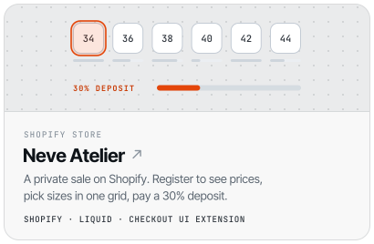</picture></a>
<a href="https://github.com/Miny320/private-winter-sale"><picture><source media="(prefers-color-scheme: dark)" srcset="assets/work-private-winter-sale-dark.svg"><source media="(prefers-color-scheme: light)" srcset="assets/work-private-winter-sale-light.svg"></picture></a>
<a href="https://github.com/Miny320/claw-machine-demo"><picture><source media="(prefers-color-scheme: dark)" srcset="assets/work-claw-machine-demo-dark.svg"><source media="(prefers-color-scheme: light)" srcset="assets/work-claw-machine-demo-light.svg"></picture></a>

Live demos: <a href="https://citeline-henna.vercel.app">Citeline</a> · <a href="https://guardian-care-updated.vercel.app">Guardian Care</a> · <a href="https://miny320.github.io/private-winter-sale/">Private Winter Sale</a>

<picture><source media="(prefers-color-scheme: dark)" srcset="assets/section-activity-dark.svg"><source media="(prefers-color-scheme: light)" srcset="assets/section-activity-light.svg"></picture>

<a href="https://github.com/Miny320"><picture><source media="(prefers-color-scheme: dark)" srcset="assets/activity-weeks-dark.svg"><source media="(prefers-color-scheme: light)" srcset="assets/activity-weeks-light.svg"></picture></a>
<a href="https://github.com/Miny320?tab=repositories"><picture><source media="(prefers-color-scheme: dark)" srcset="assets/activity-repos-dark.svg"><source media="(prefers-color-scheme: light)" srcset="assets/activity-repos-light.svg">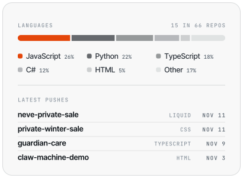</picture></a>

<a href="https://github.com/Miny320/Miny320/tree/main/scripts"><picture><source media="(prefers-color-scheme: dark)" srcset="assets/footer-dark.svg"><source media="(prefers-color-scheme: light)" srcset="assets/footer-light.svg"></picture></a>

<a href="https://github.com/Miny320?tab=repositories">All repositories</a> · <a href="https://github.com/Miny320/Miny320/tree/main/scripts">How this page is drawn</a>

